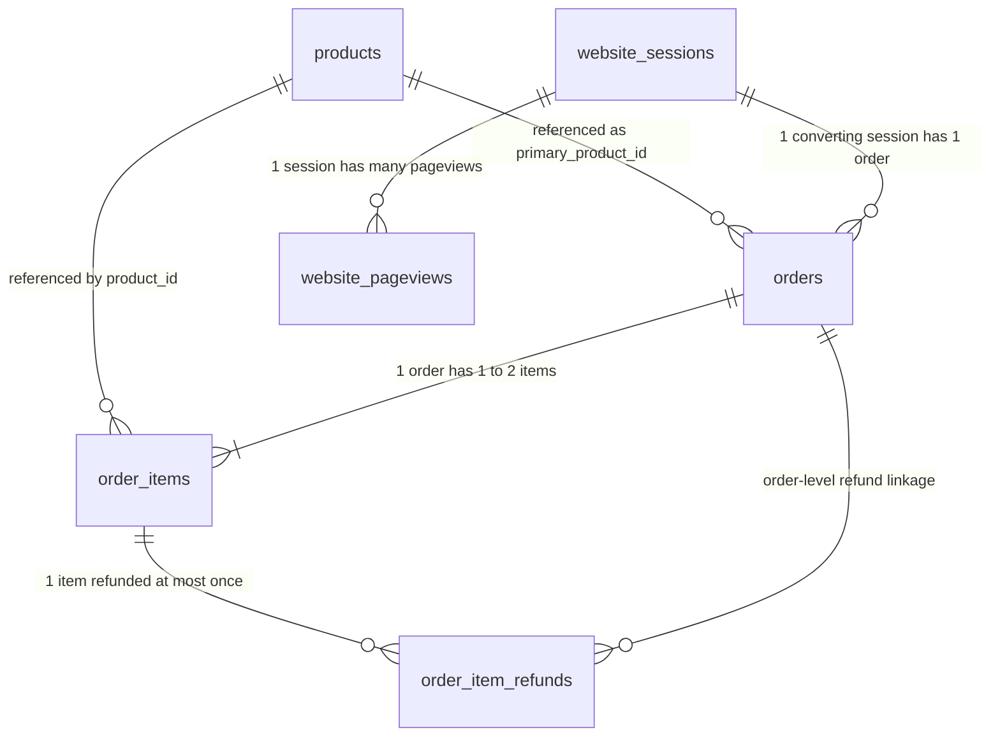

# MAVEN FUZZY FACTORY: COMPREHENSIVE DATASET DOSSIER & POWER BI ARCHITECTURE BRIEF

> **Document Purpose**: This document provides an exhaustive, mathematically verified profile of the **Maven Fuzzy Factory** eCommerce dataset (March 2012 – March 2015). It is engineered specifically for ingestion by Claude (and advanced AI analytics architects) to design and deliver an **enterprise-grade, story-driven Power BI business intelligence suite** leveraging modern data modeling, advanced DAX, and **disconnected tables for dynamic narrative storytelling and parameterization**.

---

## TABLE OF CONTENTS
1. [Executive Overview & Business Context](#1-executive-overview--business-context)
2. [Data Architecture & Relational Schema (ERD)](#2-data-architecture--relational-schema-erd)
3. [Empirical Data Profiling & Statistical Baseline](#3-empirical-data-profiling--statistical-baseline)
4. [The Five Core Business Verticals & Analytical Domains](#4-the-five-core-business-verticals--analytical-domains)
   - [Vertical 1: Traffic Acquisition & Marketing Attribution](#vertical-1-traffic-acquisition--marketing-attribution)
   - [Vertical 2: Conversion Funnel & CRO / A/B Testing](#vertical-2-conversion-funnel--cro--ab-testing)
   - [Vertical 3: Product Portfolio Growth & Cross-Selling](#vertical-3-product-portfolio-growth--cross-selling)
   - [Vertical 4: Customer Retention & Repeat Behavior](#vertical-4-customer-retention--repeat-behavior)
   - [Vertical 5: Financial Health, Profitability & Refund Quality Control](#vertical-5-financial-health-profitability--refund-quality-control)
5. [Power BI Data Modeling & Star Schema Blueprint](#5-power-bi-data-modeling--star-schema-blueprint)
6. [Disconnected Tables Architecture for Dynamic Storytelling](#6-disconnected-tables-architecture-for-dynamic-storytelling)
7. [DAX Calculation Architecture & Analytical Measures](#7-dax-calculation-architecture--analytical-measures)
8. [Proposed Report Page Hierarchy & Storyboarding](#8-proposed-report-page-hierarchy--storyboarding)
9. [Direct Prompt & Instructions for Claude](#9-direct-prompt--instructions-for-claude)

---

## 1. EXECUTIVE OVERVIEW & BUSINESS CONTEXT

### 1.1 The Company
**Maven Fuzzy Factory** is an eCommerce Direct-to-Consumer (DTC) retailer specializing in plush stuffed toys. The business launched in **March 2012** with a single flagship product (*The Original Mr. Fuzzy*) and scaled over a 3-year period through **March 2015** into a multi-product catalog with diversified marketing channels, sophisticated A/B-tested web funnels, and repeat customer retention engines.

### 1.2 The 3-Year Strategic Growth Chronology
- **Year 1 (2012) — The Search-Driven Bootstrap**:
  - Heavily reliant on paid Google search (`gsearch` nonbrand).
  - High desktop vs. mobile conversion disparity discovered early on.
  - Initial website optimization experiments began (`/home` vs. `/lander-1`).
  - Critical checkout billing funnel overhaul (`/billing` vs. `/billing-2`).
- **Year 2 (2013) — Channel & Product Diversification**:
  - Diversified search marketing onto Bing (`bsearch`).
  - Launched Product 2 (*The Forever Love Bear*) in January 2013 ahead of Valentine's Day.
  - Launched Product 3 (*The Birthday Sugar Panda*) in December 2013.
  - Introduced multiple targeted landing pages (`/lander-2`, `/lander-3`).
- **Year 3 (2014) — Omnichannel Scale & Cross-Selling Revolution**:
  - Piloted paid social media marketing (`socialbook` pilot and desktop-targeted campaigns).
  - Launched Product 4 (*The Hudson River Mini Bear*) in February 2014, unlocking high-margin cross-sell bundles.
  - Landed high-converting landing page `/lander-5`.
  - Crossed **$1,000,000** in gross revenue in a single calendar year.
- **Year 4 Q1 (2015) — Operational Maturity**:
  - All-time peak website conversion rate (>8.4%).
  - Significant organic search and direct brand awareness flywheels.

---

## 2. DATA ARCHITECTURE & RELATIONAL SCHEMA (ERD)

The dataset consists of **6 relational CSV tables** capturing granular web traffic, pageviews, orders, line items, refunds, and product metadata.



### 2.1 Table-by-Table Technical Specifications

#### Table 1: `products.csv` (Catalog Dimension)
- **Granularity**: 1 row per product in the catalog.
- **Row Count**: 4 rows.
- **Columns**:
  - `product_id` (INT, Primary Key): Unique identifier (1, 2, 3, 4).
  - `created_at` (DATETIME): Product catalog launch timestamp.
  - `product_name` (VARCHAR): Product brand name.

| product_id | created_at | product_name | Retail Price (USD) | COGS (USD) | Margin | Margin % | Primary Role |
| :---: | :---: | :--- | :---: | :---: | :---: | :---: | :--- |
| **1** | 2012-03-19 08:00:00 | The Original Mr. Fuzzy | $49.99 | $19.49 | $30.50 | 61.01% | Flagship Launch Bear |
| **2** | 2013-01-06 13:00:00 | The Forever Love Bear | $59.99 | $22.49 | $37.50 | 62.51% | Premium Romance / Valentine's |
| **3** | 2013-12-12 09:00:00 | The Birthday Sugar Panda | $45.99 | $14.49 | $31.50 | 68.49% | High-Margin Birthday Gift |
| **4** | 2014-02-05 10:00:00 | The Hudson River Mini bear | $29.99 | $9.49 | $20.50 | 68.36% | Pocket Add-on / Cross-Sell Item |

---

#### Table 2: `website_sessions.csv` (Traffic & Attribution Fact)
- **Granularity**: 1 row per visitor session on the website.
- **Row Count**: 472,871 rows.
- **Date Range**: `2012-03-19 08:04:16` to `2015-03-19 07:59:08` (Exactly 36 continuous months).
- **Unique Users**: 394,318 distinct `user_id` values.
- **Columns**:
  - `website_session_id` (INT, Primary Key): Unique session ID.
  - `created_at` (DATETIME): Session start timestamp.
  - `user_id` (INT, Foreign Key): Identifier of the visiting user (enables user retention and lifetime tracking).
  - `is_repeat_session` (TINYINT): Binary flag (`0` = First visit, `1` = Repeat visit).
  - `utm_source` (VARCHAR, Nullable): Paid marketing source (`gsearch`, `bsearch`, `socialbook`, or `NULL`).
  - `utm_campaign` (VARCHAR, Nullable): Campaign type (`nonbrand`, `brand`, `desktop_targeted`, `pilot`, or `NULL`).
  - `utm_content` (VARCHAR, Nullable): Ad copy / banner variation (`g_ad_1`, `b_ad_1`, `social_ad_1`, etc.).
  - `device_type` (VARCHAR): Device used (`desktop` [327,027 sessions], `mobile` [145,844 sessions]).
  - `http_referer` (VARCHAR, Nullable): Referring URL domain (`https://www.gsearch.com`, `https://www.bsearch.com`, or `NULL`).

> [!IMPORTANT]
> **Critical Attribution Logic (NULL Handling)**:
> In 83,328 sessions (17.62% of traffic), `utm_source`, `utm_campaign`, and `utm_content` are `NULL`.
> - If `utm_source` is **NULL** AND `http_referer` is **NULL** (39,917 sessions) $\rightarrow$ **Direct Type-In Traffic** (User typed URL directly or used bookmarks).
> - If `utm_source` is **NULL** AND `http_referer` is **NOT NULL** (43,411 sessions: 35,202 from Google, 8,209 from Bing) $\rightarrow$ **Organic Search Traffic** (Unpaid search engine discovery).
> - If `utm_source` is **NOT NULL** $\rightarrow$ **Paid Campaign Traffic** (`gsearch`, `bsearch`, `socialbook`).

---

#### Table 3: `website_pageviews.csv` (Clickstream & Funnel Fact)
- **Granularity**: 1 row per page viewed during a website session.
- **Row Count**: 1,188,124 rows.
- **Average Pageviews / Session**: 2.51.
- **Columns**:
  - `website_pageview_id` (INT, Primary Key): Unique pageview ID.
  - `created_at` (DATETIME): Timestamp of the pageview.
  - `website_session_id` (INT, Foreign Key): Links to `website_sessions.csv`.
  - `pageview_url` (VARCHAR): The specific URL path accessed.

**Complete Pageview URL Taxonomy & Volume Distribution**:
1. **Entry / Landing Pages**:
   - `/home`: 137,576 hits (The original homepage).
   - `/lander-1`: 47,574 hits (First lander experiment, June 2012 – March 2013).
   - `/lander-2`: 131,170 hits (Second major lander, Jan 2013 – Dec 2014).
   - `/lander-3`: 79,000 hits (Third lander, July 2013 – March 2015).
   - `/lander-4`: 9,385 hits (Short-lived test, Feb 2014 – April 2014).
   - `/lander-5`: 68,166 hits (High-converting winner, August 2014 – March 2015).
2. **Product Catalog & Detail Pages**:
   - `/products`: 261,231 hits (Product browse / collection page).
   - `/the-original-mr-fuzzy`: 162,525 hits.
   - `/the-forever-love-bear`: 26,033 hits.
   - `/the-birthday-sugar-panda`: 19,046 hits.
   - `/the-hudson-river-mini-bear`: 2,610 hits.
3. **Checkout Conversion Funnel**:
   - `/cart`: 94,953 hits (Add to cart stage).
   - `/shipping`: 64,484 hits (Shipping info entry).
   - `/billing`: 3,617 hits (Original billing page, replaced after A/B test).
   - `/billing-2`: 48,441 hits (New high-converting billing page).
   - `/thank-you-for-your-order`: 32,313 hits (Purchase confirmation / Conversion flag).

---

#### Table 4: `orders.csv` (Order Fact Table)
- **Granularity**: 1 row per completed purchase transaction.
- **Row Count**: 32,313 rows.
- **Date Range**: `2012-03-19 10:42:46` to `2015-03-19 05:38:31`.
- **Columns**:
  - `order_id` (INT, Primary Key): Unique order ID.
  - `created_at` (DATETIME): Purchase timestamp.
  - `website_session_id` (INT, Foreign Key): Exactly 1 order per session (32,313 unique sessions converted).
  - `user_id` (INT, Foreign Key): Purchasing customer ID (31,696 unique buyers).
  - `primary_product_id` (INT, Foreign Key): Product ID that served as the primary intent item.
  - `items_purchased` (INT): Total items in basket (`1` item in 24,601 orders; `2` items in 7,712 orders).
  - `price_usd` (DECIMAL): Total gross revenue of the order.
  - `cogs_usd` (DECIMAL): Total cost of goods sold for the order.

---

#### Table 5: `order_items.csv` (Line Item Fact Table)
- **Granularity**: 1 row per individual product purchased in an order.
- **Row Count**: 40,025 rows.
- **Columns**:
  - `order_item_id` (INT, Primary Key): Unique line item ID.
  - `created_at` (DATETIME): Purchase timestamp.
  - `order_id` (INT, Foreign Key): Links to `orders.csv`.
  - `product_id` (INT, Foreign Key): Links to `products.csv`.
  - `is_primary_item` (TINYINT): `1` = Main item ordered (32,313 rows), `0` = Cross-sell / add-on item (7,712 rows).
  - `price_usd` (DECIMAL): Unit sales price.
  - `cogs_usd` (DECIMAL): Unit cost of goods sold.

---

#### Table 6: `order_item_refunds.csv` (Refund Fact Table)
- **Granularity**: 1 row per refunded item.
- **Row Count**: 1,731 rows.
- **Date Range**: `2012-04-05 15:47:04` to `2015-03-24 16:03:00`.
- **Columns**:
  - `order_item_refund_id` (INT, Primary Key): Unique refund ID.
  - `created_at` (DATETIME): Refund issuance timestamp.
  - `order_item_id` (INT, Foreign Key): Unique refunded line item (each line item refunded at most once).
  - `order_id` (INT, Foreign Key): Links to `orders.csv`.
  - `refund_amount_usd` (DECIMAL): Exact dollar amount refunded (100% equal to item unit price).
- **Lag Analysis**:
  - Refunds occur between **2 to 16 days** after order date (Average lag: **9.0 days**).
  - Requires Role-Playing Date Dimension in Power BI to isolate *Cohort Refund Rate (by Order Date)* from *Cash Refund Outflow (by Refund Date)*.

---

## 3. EMPIRICAL DATA PROFILING & STATISTICAL BASELINE

All figures below are mathematically verified against the raw database:

### 3.1 High-Level KPI Scorecard
| Metric | Value | Business Interpretation |
| :--- | :---: | :--- |
| **Total Website Sessions** | **472,871** | Total traffic over 3 years |
| **Total Unique Visitors** | **394,318** | Distinct users reached |
| **Total Pageviews** | **1,188,124** | 2.51 pageviews/session average engagement |
| **Total Orders** | **32,313** | Converted purchase sessions |
| **Total Units Sold** | **40,025** | Total items manufactured & shipped |
| **Blended Conversion Rate (CVR)** | **6.83%** | Sessions $\rightarrow$ Orders conversion efficiency |
| **Gross Revenue** | **$1,938,509.75** | Total sales before refunds |
| **Cost of Goods Sold (COGS)** | **$722,370.25** | Direct manufacturing/product costs |
| **Gross Profit** | **$1,216,139.50** | Gross profit margin of **62.74%** |
| **Total Refunds Issued** | **$85,338.69** | 1,731 items returned (4.32% refund rate by volume) |
| **Net Revenue** | **$1,853,171.06** | Gross Revenue minus Refunds |
| **Net Profit (Gross - Refunds)** | **$1,130,800.81** | Net margin after product cost and returns |
| **Average Order Value (AOV)** | **$60.00** | Gross Revenue / Orders |
| **Multi-Item Basket Attach Rate** | **23.87%** | 7,712 out of 32,313 orders contained 2 items |
| **Site-Wide Bounce Rate** | **44.76%** | 211,640 single-pageview drop-offs |

---

### 3.2 Annual Growth & Trajectory Breakdown
| Year | Sessions | Orders | CVR % | Gross Revenue | COGS | Gross Margin % | Refunds | Net Revenue |
| :---: | :---: | :---: | :---: | :---: | :---: | :---: | :---: | :---: |
| **2012** (Mar-Dec) | 62,470 | 2,586 | 4.14% | $129,274.14 | $50,401.14 | 61.01% | $8,898.22 | $120,375.92 |
| **2013** (Full Year) | 112,781 | 7,447 | 6.60% | $393,247.87 | $151,651.37 | 61.44% | $17,046.64 | $376,201.23 |
| **2014** (Full Year) | 233,422 | 16,860 | 7.22% | $1,075,612.19 | $395,889.69 | 63.20% | $48,142.15 | $1,027,470.04 |
| **2015** (Jan-Mar 19) | 64,198 | 5,420 | **8.44%** | $340,375.55 | $124,428.05 | 63.44% | $11,251.68 | $329,123.87 |

> [!NOTE]
> **Key Insight**: Conversion rate steadily climbed from **4.14% in 2012** to **8.44% in early 2015** — more than doubling efficiency through systematic A/B testing and checkout optimization.

---

### 3.3 Product Performance & Unit Economics Matrix
| Product ID & Name | Units Sold | Primary Units | Cross-Sell Units | Gross Revenue | Unit Price | Unit COGS | Refunds | Refund Rate % | Net Revenue |
| :--- | :---: | :---: | :---: | :---: | :---: | :---: | :---: | :---: | :---: |
| **P1: Mr. Fuzzy** | 24,226 | 23,861 | 365 | $1,211,057.74 | $49.99 | $19.49 | 1,237 | **5.11%** | $1,149,220.11 |
| **P2: Love Bear** | 5,796 | 4,803 | 993 | $347,702.04 | $59.99 | $22.49 | 129 | **2.23%** | $339,963.33 |
| **P3: Sugar Panda** | 4,985 | 3,068 | 1,917 | $229,260.15 | $45.99 | $14.49 | 301 | **6.04%** | $215,417.16 |
| **P4: Mini Bear** | 5,018 | 581 | **4,437** | $150,489.82 | $29.99 | $9.49 | 64 | **1.28%** | $148,570.46 |
| **TOTAL** | **40,025** | **32,313** | **7,712** | **$1,938,509.75** | — | — | **1,731** | **4.32%** | **$1,853,171.06** |

---

## 4. THE FIVE CORE BUSINESS VERTICALS & ANALYTICAL DOMAINS

Claude must design analytical solutions covering all five of these business domains:

### Vertical 1: Traffic Acquisition & Marketing Attribution
- **Paid Search (`gsearch` vs. `bsearch`)**:
  - `gsearch nonbrand` drove 282,706 sessions (59.8% of total volume), generating $1.12M in gross revenue.
  - `bsearch nonbrand` was introduced in August 2012 to capture incremental search demand (54,909 sessions, $225.5K revenue).
- **Brand Equity vs. Paid Acquisition**:
  - Brand search (`gsearch brand` and `bsearch brand`) converts at **10.3%** on desktop, mirroring the organic/direct audience.
  - Brand sessions grew as brand awareness accumulated:
    - 2012: 1,844 brand sessions
    - 2013: 8,300 brand sessions (+350%)
    - 2014: 23,890 brand sessions (+188%)
- **Device Disparity (The Mobile Optimization Problem)**:
  - **Desktop CVR**: ~**8.2% to 10.5%** across all major channels.
  - **Mobile CVR**: ~**2.3% to 3.4%** across all channels.
  - Mobile generated 30.8% of traffic (145,844 sessions) but only 13.9% of orders (4,491 orders).
- **Paid Social Media Pilot Experiment**:
  - `socialbook pilot` (Jan–Mar 2014) performed poorly overall (4,573 mobile visits @ **0.83% CVR**; 522 desktop visits @ **3.26% CVR**).
  - The team iterated to launch `socialbook desktop_targeted` (Aug–Dec 2014), achieving a **5.15% CVR** (288 orders, $18.5K revenue).
- **Direct & Organic Flywheel**:
  - Unpaid traffic (Direct Type-In + Organic Search) accounted for 83,328 sessions (17.6% of total site traffic) and generated **$371,433** in revenue with zero ad spend.

---

### Vertical 2: Conversion Funnel & CRO / A/B Testing
- **Landing Page A/B Testing Suite**:
  Every session entered through one of 6 landing pages:
  - `/home`: 137,576 sessions | 41.68% bounce | 7.06% CVR | Baseline site homepage.
  - `/lander-1`: 47,574 sessions | 53.24% bounce | 4.53% CVR | Early custom lander test (underperformed baseline).
  - `/lander-2`: 131,170 sessions | 45.17% bounce | 7.72% CVR | Scaled nonbrand acquisition lander.
  - `/lander-3`: 79,000 sessions | 50.29% bounce | 3.39% CVR | Tested targeted messaging.
  - `/lander-4`: 9,385 sessions | 51.69% bounce | 7.54% CVR | Limited seasonal test.
  - `/lander-5`: 68,166 sessions | **36.87% bounce** | **10.17% CVR** | Highest converting lander in company history!
- **The Famous Billing Funnel Overhaul (A/B Test)**:
  - Original `/billing`: 3,617 visits $\rightarrow$ 1,620 orders (**44.79% progression to purchase**).
  - Redesigned `/billing-2`: 48,441 visits $\rightarrow$ 30,693 orders (**63.36% progression to purchase**).
  - **Impact**: An **+18.57 percentage point lift** (+41.4% relative gain) at the final checkout step, adding an estimated **+$450,000+** in incremental revenue over the dataset timeframe.
- **Funnel Progression Benchmarks**:
  - Step 1: Lander Visit $\rightarrow$ Step 2: Browse `/products` (55.2% click-through).
  - Step 2: `/products` $\rightarrow$ Step 3: Product Detail View (76.8% click-through).
  - Step 3: Product Detail $\rightarrow$ Step 4: `/cart` (45.1% add-to-cart rate).
  - Step 4: `/cart` $\rightarrow$ Step 5: `/shipping` (67.9% progression).
  - Step 5: `/shipping` $\rightarrow$ Step 6: `/billing-2` (80.7% progression).
  - Step 6: `/billing-2` $\rightarrow$ Step 7: `/thank-you-for-your-order` (63.4% purchase completion).

---

### Vertical 3: Product Portfolio Growth & Cross-Selling
- **The 4-Product Evolution**:
  - Single-product business until January 2013 (Mr. Fuzzy exclusively).
  - Love Bear introduced for Valentine's Day 2013 ($59.99 premium price, highest customer satisfaction with only 2.2% refund rate).
  - Sugar Panda introduced in Dec 2013 (strong initial volume, but experienced high return rate of 6.04%).
  - Hudson River Mini Bear launched in Feb 2014 specifically engineered as an **impulse cross-sell add-on**.
- **Cross-Sell Dynamics**:
  - Before Product 4 launch: 100% of orders were single-item orders ($49.99 or $59.99 AOV).
  - After Product 4 launch: **88.4% of Mini Bear units sold (4,437 of 5,018) were cross-sell attachments** at checkout.
  - Cross-sell attach rate rose to **23.87%** of all orders, lifting overall company AOV from $50.00 to over $60.00 without increasing acquisition traffic costs.

---

### Vertical 4: Customer Retention & Repeat Behavior
- **User Engagement Metrics**:
  - 394,318 unique visitors logged across 3 years.
  - 343,048 users visited once (87.0%).
  - 51,270 users returned for repeat sessions (13.0%).
  - Total repeat sessions: **78,553**.
- **Conversion Advantage of Repeat Sessions**:
  - First-time sessions (`is_repeat_session = 0`): **6.64% CVR** (26,164 orders from 394,318 sessions).
  - Repeat sessions (`is_repeat_session = 1`): **7.83% CVR** (6,149 orders from 78,553 sessions) — **+18.0% higher propensity to purchase**.
- **Customer Repeat Purchase Distribution**:
  - 1-time buyers: 31,105 customers.
  - 2-time buyers: 565 customers.
  - 3-time buyers: 26 customers.
  - Total Repeat Orders: 617 orders generating **$37,020** in pure retention revenue.

---

### Vertical 5: Financial Health, Profitability & Refund Quality Control
- **Gross Margin Stability**:
  - Maintained healthy 61.0% to 63.4% gross profit margin across all 3 years.
- **Refund Lag & Cashflow Exposure**:
  - 1,731 refunds totaling **$85,338.69**.
  - Average time between purchase and refund is 9 days (up to 16 days).
- **Product Defect & Customer Discontent Early Warning**:
  - **P3 Sugar Panda**: Highest refund rate (6.04%) $\rightarrow$ Potential supplier quality issue or misleading marketing imagery.
  - **P1 Mr. Fuzzy**: Moderate refund rate (5.11%).
  - **P2 Love Bear**: Low refund rate (2.23%) $\rightarrow$ Superior manufacturing or buyer satisfaction.
  - **P4 Mini Bear**: Lowest refund rate (1.28%) $\rightarrow$ Extremely low return risk.

---

## 5. POWER BI DATA MODELING & STAR SCHEMA BLUEPRINT

To ensure optimal VertiPaq compression, lightning-fast DAX evaluation, and intuitive end-user self-service, the tabular data model must be structured as follows:

```mermaid
classDiagram
    class Dim_Date {
        +Date DateKey
        +Year
        +Quarter
        +MonthName
        +MonthNumber
        +WeekOfYear
        +DayOfWeek
        +IsWeekend
    }
    class Dim_Product {
        +product_id ProductKey
        +product_name
        +created_at LaunchDate
        +unit_price
        +unit_cogs
    }
    class Dim_Channel {
        +ChannelKey
        +utm_source
        +utm_campaign
        +http_referer
        +Channel_Grouping
        +Traffic_Type
    }
    class Dim_Device {
        +device_type DeviceKey
    }
    class Dim_Lander {
        +pageview_url LanderKey
        +Lander_Name
    }
    class Fact_Orders {
        +order_id PK
        +website_session_id FK
        +user_id FK
        +primary_product_id FK
        +created_at OrderDate
        +items_purchased
        +price_usd
        +cogs_usd
    }
    class Fact_OrderItems {
        +order_item_id PK
        +order_id FK
        +product_id FK
        +created_at OrderDate
        +is_primary_item
        +price_usd
        +cogs_usd
    }
    class Fact_Sessions {
        +website_session_id PK
        +user_id FK
        +created_at SessionDate
        +is_repeat_session
        +ChannelKey FK
        +device_type FK
    }
    class Fact_Refunds {
        +order_item_refund_id PK
        +order_item_id FK
        +order_id FK
        +created_at RefundDate
        +refund_amount_usd
    }

    Dim_Date ||--o{ Fact_Sessions : "SessionDate (Active)"
    Dim_Date ||--o{ Fact_Orders : "OrderDate (Active)"
    Dim_Date ||--o{ Fact_OrderItems : "OrderDate (Active)"
    Dim_Date ||--o{ Fact_Refunds : "RefundDate (Active) / OrderDate (Inactive)"
    Dim_Product ||--o{ Fact_OrderItems : "product_id"
    Dim_Product ||--o{ Fact_Orders : "primary_product_id"
    Dim_Channel ||--o{ Fact_Sessions : "ChannelKey"
    Dim_Device ||--o{ Fact_Sessions : "device_type"
    Fact_Sessions ||--o{ Fact_Orders : "website_session_id"
    Fact_Orders ||--o{ Fact_OrderItems : "order_id"
    Fact_OrderItems ||--o{ Fact_Refunds : "order_item_id"
```

### 5.1 Modeling Recommendations for Claude:
1. **Fact Table Granularity**:
   - `Fact_OrderItems` is the atomic grain for product sales, revenue, COGS, and margin analysis.
   - `Fact_Orders` represents basket-level transactions and checkout conversion.
   - `Fact_Sessions` represents traffic acquisition and marketing ROI.
   - `Fact_Refunds` can either be related directly to `Fact_OrderItems` via 1:1 relationship or merged into `Fact_OrderItems` via Power Query / DAX calculated column (`RefundDate`, `RefundAmount`).
2. **Channel Grouping Column (in Dim_Channel or Fact_Sessions)**:
   ```dax
   Channel Grouping = 
   SWITCH(
       TRUE(),
       ISBLANK(Fact_Sessions[utm_source]) && ISBLANK(Fact_Sessions[http_referer]), "Direct Type-In",
       ISBLANK(Fact_Sessions[utm_source]) && NOT(ISBLANK(Fact_Sessions[http_referer])), "Organic Search",
       Fact_Sessions[utm_source] = "gsearch" && Fact_Sessions[utm_campaign] = "brand", "Paid: Google Brand",
       Fact_Sessions[utm_source] = "gsearch" && Fact_Sessions[utm_campaign] = "nonbrand", "Paid: Google Nonbrand",
       Fact_Sessions[utm_source] = "bsearch" && Fact_Sessions[utm_campaign] = "brand", "Paid: Bing Brand",
       Fact_Sessions[utm_source] = "bsearch" && Fact_Sessions[utm_campaign] = "nonbrand", "Paid: Bing Nonbrand",
       Fact_Sessions[utm_source] = "socialbook", "Paid Social",
       "Other"
   )
   ```

---

## 6. DISCONNECTED TABLES ARCHITECTURE FOR DYNAMIC STORYTELLING

> [!IMPORTANT]
> **The Secret Weapon for Executive Storytelling in Power BI**:
> Disconnected tables do **not** have relationships to fact tables. Instead, they store parameter lists, scenario sliders, story chapter guides, and metric switchers. DAX measures read the user's selection using `SELECTEDVALUE()` to dynamically swap formulas, format strings, chart axes, benchmark lines, and text narratives.

Claude must incorporate the following **6 Disconnected Tables**:

---

### Disconnected Table 1: `_Param_MetricSelector` (Dynamic KPI Switcher)
Enables executives to switch any visual (trend line, bar chart, heat map) between different business lenses using a single slicer.

```sql
-- Conceptual Table Definition:
CREATE TABLE _Param_MetricSelector (
    MetricID INT PRIMARY KEY,
    MetricName VARCHAR(50),
    Category VARCHAR(30),
    FormatType VARCHAR(20),
    SortOrder INT
);
```
**Data Rows**:
| MetricID | MetricName | Category | FormatType | SortOrder |
| :---: | :--- | :--- | :--- | :---: |
| 1 | Gross Revenue ($) | Financial | Currency | 1 |
| 2 | Net Revenue ($) | Financial | Currency | 2 |
| 3 | Gross Margin ($) | Financial | Currency | 3 |
| 4 | Gross Margin % | Financial | Percentage | 4 |
| 5 | Total Orders | Sales Volume | Integer | 5 |
| 6 | Total Sessions | Traffic | Integer | 6 |
| 7 | Conversion Rate (CVR %) | Efficiency | Percentage | 7 |
| 8 | Average Order Value ($) | Basket | Currency | 8 |
| 9 | Cross-Sell Attach % | Basket | Percentage | 9 |
| 10 | Refund Rate % | Quality | Percentage | 10 |

**Universal DAX Implementation Pattern**:
```dax
Dynamic Selected Metric = 
VAR SelectedMetricID = SELECTEDVALUE(_Param_MetricSelector[MetricID], 1)
RETURN
    SWITCH(
        SelectedMetricID,
        1, [Gross Revenue],
        2, [Net Revenue],
        3, [Gross Profit],
        4, [Gross Margin %],
        5, [Total Orders],
        6, [Total Sessions],
        7, [Conversion Rate %],
        8, [Average Order Value],
        9, [Cross-Sell Attach Rate %],
        10, [Refund Rate %],
        [Gross Revenue]
    )
```

---

### Disconnected Table 2: `_Param_TimeIntelligence` (Comparison Period Switcher)
Allows switching time-series charts between Current Period, Prior Period (PoP), Prior Year (YoY), and Rolling Averages without duplicating visuals.

| TimeModeID | TimeModeName | Description |
| :---: | :--- | :--- |
| 1 | Current Actuals | Shows base metric for the selected date range |
| 2 | Previous Period (PoP) | Compares against immediate prior period |
| 3 | Previous Year (YoY) | Compares against same period last year |
| 4 | YoY Variance ($ / Vol) | Shows absolute dollar or volume change vs prior year |
| 5 | YoY Variance % | Shows percentage change vs prior year |
| 6 | Rolling 30 Days | Smooths out daily noise with 30-day moving average |

---

### Disconnected Table 3: `_Param_DimensionSlicer` (Dynamic Axis / Matrix Slicer)
Allows dynamic swapping of matrix rows and chart X-axes between:
- "Marketing Channel Grouping"
- "Device Category (Desktop vs Mobile)"
- "Primary Product"
- "Landing Page Variant"
- "Campaign Type"

---

### Disconnected Table 4: `_Param_StoryNavigator` (Executive Narrative & Chapter Guide)
This table powers an **interactive narrative bar** that guides an executive through the 5 historical milestones of the company. Clicking a chapter filters the report, updates narrative cards, and displays contextual business commentary.

| ChapterID | ChapterName | Timeframe | NarrativeHeadline | ContextCommentary |
| :---: | :--- | :--- | :--- | :--- |
| **1** | Chapter 1: The Search Launch | Mar 2012 – Sep 2012 | "Bootstrapping on Google Paid Search" | Single product (Mr. Fuzzy), high desktop dependency, baseline conversion ~3.5%. |
| **2** | Chapter 2: The Billing Breakthrough | Sep 2012 – Jan 2013 | "Fixing the Leaky Checkout Bucket" | Billing-2 A/B test launched, lifting checkout completion from 44.8% to 63.4%. |
| **3** | Chapter 3: Channel Diversification | Jan 2013 – Dec 2013 | "Expanding Search & Introducing Love Bear" | Bing paid search launched, Love Bear added, conversion crossed 6.6%. |
| **4** | Chapter 4: Cross-Sell Revolution | Feb 2014 – Dec 2014 | "The Hudson Mini Bear Basket Multiplier" | Mini Bear launched as cross-sell add-on, lifting AOV from $50 to $60 and hitting $1M+ annual revenue. |
| **5** | Chapter 5: Scaled Brand Maturity | Jan 2015 – Mar 2015 | "The Omnichannel High-Conversion Machine" | Conversion peaks at 8.44%, organic/direct traffic compounds, $1.85M net revenue reached. |

**Dynamic Narrative Card Measure**:
```dax
Story Headline Text = 
SELECTEDVALUE(
    _Param_StoryNavigator[NarrativeHeadline], 
    "Maven Fuzzy Factory: 3-Year Historical Growth Journey (2012-2015)"
)

Story Narrative Commentary = 
SELECTEDVALUE(
    _Param_StoryNavigator[ContextCommentary], 
    "Select a chapter from the storyline bar to explore how strategic marketing, UX testing, and product expansion transformed Maven Fuzzy Factory into a multimillion-dollar eCommerce brand."
)
```

---

### Disconnected Table 5: `_Param_WhatIf_Scenarios` (Interactive Executive Simulator)
Allows business stakeholders to simulate future revenue gains based on 3 sliders:
1. `_Param_CVR_Lift`: Slider from `-20%` to `+50%` in 1% steps.
2. `_Param_Refund_Reduction`: Slider from `0%` to `-50%` in 1% steps.
3. `_Param_CrossSell_Attach`: Slider from `0%` to `+40%` in 1% steps.

**Simulation DAX Logic**:
```dax
Simulated Additional Orders = 
VAR BaseSessions = [Total Sessions]
VAR BaseCVR = [Conversion Rate %]
VAR LiftPercent = SELECTEDVALUE(_Param_CVR_Lift[LiftValue], 0)
VAR TargetCVR = BaseCVR * (1 + LiftPercent)
RETURN
    (BaseSessions * TargetCVR) - [Total Orders]

Simulated Net Revenue Impact = 
VAR ExtraOrders = [Simulated Additional Orders]
VAR BaseAOV = [Average Order Value]
VAR ExtraRevenue = ExtraOrders * BaseAOV
VAR RefundSavingPercent = ABS(SELECTEDVALUE(_Param_Refund_Reduction[ReductionValue], 0))
VAR RefundSavings = [Total Refund Amount] * RefundSavingPercent
RETURN
    ExtraRevenue + RefundSavings
```

---

### Disconnected Table 6: `_Param_BenchmarkTarget` (Dynamic Target & Pacing Switcher)
Allows toggling comparative KPI benchmarks on visuals:
- `Target Mode 1`: Company Budget (e.g., 7.5% CVR Target).
- `Target Mode 2`: Prior Year Benchmark.
- `Target Mode 3`: Industry DTC Benchmark (e.g., 5.0% CVR, $55 AOV).

---

## 7. DAX CALCULATION ARCHITECTURE & ANALYTICAL MEASURES

Claude must provide clean, production-grade DAX expressions across these core categories:

### 7.1 Core Financial & Volume Measures
```dax
// 1. Total Sessions
Total Sessions = COUNTROWS(Fact_Sessions)

// 2. Total Orders
Total Orders = COUNTROWS(Fact_Orders)

// 3. Gross Revenue
Gross Revenue = SUM(Fact_OrderItems[price_usd])

// 4. Total COGS
Total COGS = SUM(Fact_OrderItems[cogs_usd])

// 5. Gross Profit
Gross Profit = [Gross Revenue] - [Total COGS]

// 6. Gross Margin %
Gross Margin % = DIVIDE([Gross Profit], [Gross Revenue], 0)

// 7. Total Refund Amount
Total Refund Amount = SUM(Fact_Refunds[refund_amount_usd])

// 8. Net Revenue
Net Revenue = [Gross Revenue] - [Total Refund Amount]

// 9. Net Margin %
Net Margin % = DIVIDE([Net Revenue] - [Total COGS], [Net Revenue], 0)

// 10. Average Order Value (AOV)
Average Order Value = DIVIDE([Gross Revenue], [Total Orders], 0)

// 11. Conversion Rate %
Conversion Rate % = DIVIDE([Total Orders], [Total Sessions], 0)
```

### 7.2 Funnel & CRO Measures
```dax
// 12. Bounced Sessions
Bounced Sessions = 
CALCULATE(
    COUNTROWS(Fact_Sessions),
    FILTER(
        Fact_Sessions,
        CALCULATE(COUNTROWS(Fact_WebsitePageviews)) = 1
    )
)

// 13. Bounce Rate %
Bounce Rate % = DIVIDE([Bounced Sessions], [Total Sessions], 0)

// 14. Billing Progression Rate
Billing Conversion % = 
VAR BillingVisits = CALCULATE(COUNTROWS(Fact_WebsitePageviews), Fact_WebsitePageviews[pageview_url] IN {"/billing", "/billing-2"})
VAR ConvertedOrders = [Total Orders]
RETURN
    DIVIDE(ConvertedOrders, BillingVisits, 0)
```

### 7.3 Product & Cross-Sell Measures
```dax
// 15. Cross-Sell Units Sold
Cross-Sell Units = 
CALCULATE(
    COUNTROWS(Fact_OrderItems),
    Fact_OrderItems[is_primary_item] = 0
)

// 16. Cross-Sell Attach Rate %
Cross-Sell Attach Rate % = 
DIVIDE([Cross-Sell Units], [Total Orders], 0)

// 17. Product Refund Rate % (by Volume)
Product Refund Rate % = 
VAR TotalProductUnits = COUNTROWS(Fact_OrderItems)
VAR RefundedProductUnits = COUNTROWS(Fact_Refunds)
RETURN
    DIVIDE(RefundedProductUnits, TotalProductUnits, 0)
```

### 7.4 Customer Retention & Repeat Measures
```dax
// 18. Repeat Session Count
Repeat Sessions = 
CALCULATE(
    COUNTROWS(Fact_Sessions),
    Fact_Sessions[is_repeat_session] = 1
)

// 19. Repeat Session %
Repeat Session % = DIVIDE([Repeat Sessions], [Total Sessions], 0)

// 20. Repeat Customer Order Count
Repeat Customer Orders = 
CALCULATE(
    COUNTROWS(Fact_Orders),
    FILTER(
        VALUES(Fact_Orders[user_id]),
        CALCULATE(COUNTROWS(Fact_Orders)) > 1
    )
)
```

---

## 8. PROPOSED REPORT PAGE HIERARCHY & STORYBOARDING

Claude should structure the Power BI solution into an executive 6-to-7 page storybook:

```
[ Power BI Report Structure ]
│
├── Page 1: 🌟 Executive Storyboard & Historical Milestone Navigator
│   └── Top interactive Chapter Bar (_Param_StoryNavigator), Dynamic Headline Card,
│       Executive KPI Switcher (_Param_MetricSelector), 3-Year Macro Trajectory Area Chart.
│
├── Page 2: 🎯 Marketing Acquisition & Channel Attribution
│   └── Paid vs Organic vs Direct breakdown, Device Disparity Analysis (Desktop vs Mobile),
│       Paid Search efficiency (gsearch vs bsearch, Brand vs Nonbrand), Social Media Experiment deep dive.
│
├── Page 3: 🧪 Conversion Funnel & CRO Experimentation Lab
│   └── Landing Page A/B Test comparisons (/home vs /lander-1 through /lander-5),
│       The Billing-2 Overhaul Case Study, Step-by-Step Funnel Sankey/Waterfall diagram.
│
├── Page 4: 🧸 Product Portfolio & Cross-Selling Dynamics
│   └── 4-Product lifecycle timeline, Basket analysis (1-item vs 2-item orders),
│       Hudson Mini Bear cross-sell attach rate impact, Cannibalization vs Incremental growth.
│
├── Page 5: 🔁 Customer Retention & Repeat Visitor Cohorts
│   └── New vs Repeat visitor behavior, Time-to-return histogram, Retention CVR premium,
│       Repeat customer lifetime purchase contribution.
│
├── Page 6: 💰 Financial Health, Margins & Refund Quality Control
│   └── Unit economics, Gross vs Net margin bridges, Product refund rate early warning monitor,
│       Cashflow lag analysis (Order Date vs Refund Date).
│
└── Page 7: 🔮 "What-If" Executive Scenario Simulator
    └── CVR Lift slider, Refund reduction slider, Cross-sell attach slider,
        Simulated Revenue & EBITDA impact cards, Waterfall breakdown of projected gains.
```

---

## 9. DIRECT PROMPT & INSTRUCTIONS FOR CLAUDE

When you upload this file to Claude, provide the following instruction prompt:

```markdown
Hello Claude,

I have attached a detailed specification dossier for the Maven Fuzzy Factory dataset (March 2012 – March 2015).

Please act as an Elite Power BI Solutions Architect and Lead Data Storyteller. Based on this dossier, I need you to propose the most advanced, enterprise-grade Power BI dashboard suite possible for this dataset.

Specifically, your proposal must:
1. Architectural Blueprint: Define the optimal Star Schema and Tabular Data Model, including fact table granularities, role-playing date dimensions, and relationship cardinalities.
2. Disconnected Tables for Storytelling: Provide a comprehensive design for disconnected tables that power:
   - Dynamic Metric Switching (Revenue, CVR, Margin, Orders, etc.)
   - Time Intelligence / Period Mode Switching (PoP, YoY, Rolling Averages)
   - Dynamic Dimension Slicing (Channel, Device, Product, Lander)
   - Guided Storyline Chapter Navigator (guiding stakeholders through the 5 growth chapters)
   - "What-If" Executive Scenario Modeling (simulating CVR lift, refund cuts, and cross-sell increases)
3. Production DAX Measure Library: Provide the exact, optimized DAX code for the core measures, semi-additive calculations, and disconnected table switcher logic.
4. Report UX/UI Wireframes & Page Hierarchy: Detail each page of the dashboard suite with visual types, KPI card layouts, dynamic title DAX formulas, interactive tooltips, and bookmark/drill-through interactions.
5. Modern Visual Design System: Suggest a sophisticated, executive-ready design palette (colors, contrast, typography, card borders, glassmorphism/dark mode considerations) that creates an immediate "WOW" factor for C-suite presentations.

Please be deeply specific, mathematically grounded in the figures from the dossier, and focus heavily on dynamic, interactive storytelling.
```

---
*End of Dataset Specification Dossier.*
